# Subsurface Mobile

**Your whole dive log, on your phone. In a file you own.**

A native iOS and Android companion to [Subsurface](https://subsurface-divelog.org/),
built on the same C++ core as the desktop app. It reads and writes the same SSRF
logbook, computes the same profiles, and needs no account.

<p align="center">
  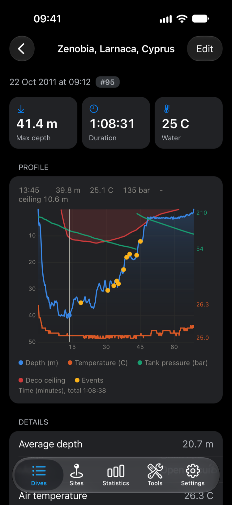
  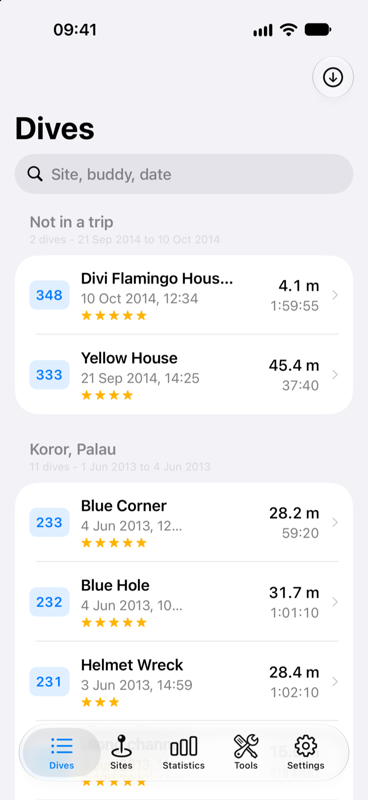
  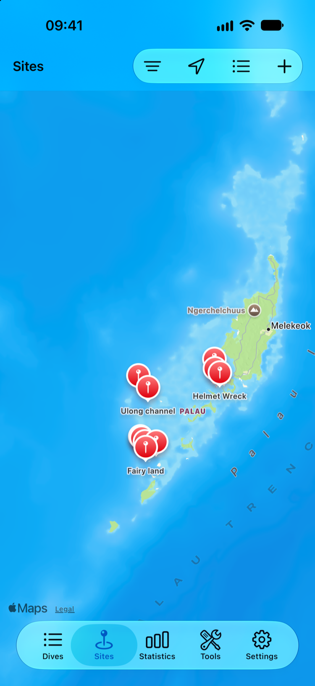
</p>

## Every dive, down to the second

Depth, water temperature, tank pressure, the decompression ceiling and the events
your computer recorded, on one chart. Drag to read off any moment, pinch to zoom,
or turn the phone sideways to give the profile the whole screen.

<p align="center">
  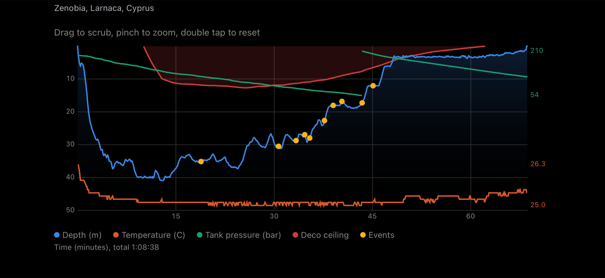
</p>

Below the chart are the numbers divers look for: SAC, OTU, CNS, average depth,
cylinders and gases. Gradient factors are yours to set, and the ceiling is drawn
to match.

## Bring the log you already have

- **Subsurface:** open or merge `.ssrf` and `.xml` logbooks, and export them for the
  desktop app. It is the same serializer on both sides.
- **Suunto:** import DM4 and DM5 databases, `.sde` archives, and the XML and JSON the
  Suunto app exports.
- **SSI:** choose dives to add from your SSI logbook, or push a dive to it.
- **Files, Mail, AirDrop:** open a logbook from anywhere, then choose to open it or
  merge it.
- **Dive computers:** download over Bluetooth LE through libdivecomputer, with
  vendors including Aqualung, Cressi, Heinrichs Weikamp, Mares, Oceanic, Scubapro
  and Shearwater.

> **Status:** Bluetooth download has been tested against a simulated dive computer
> only, not yet against real hardware. See
> [the task notes](docs/tasks/14-dive-computer-download.md) for how to check it.

<p align="center">
  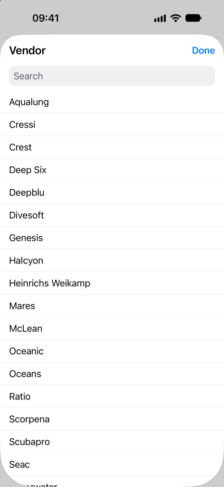
  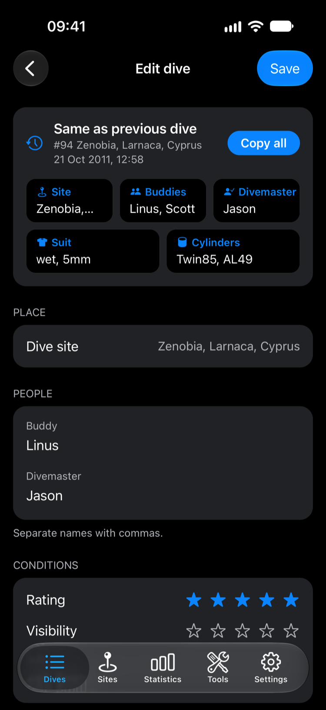
  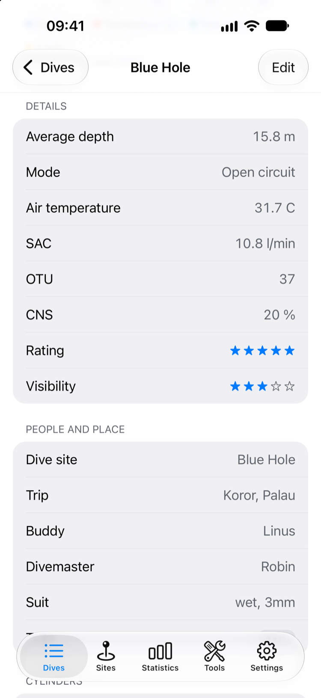
</p>

Logging a trip is quick too. **Same as previous dive** copies the site, buddies,
divemaster, suit and cylinders in one tap.

## See where you have been

Every site with coordinates sits on a map, and each one lists the dives you did
there. Add sites, edit them, or switch to a plain list.

<p align="center">
  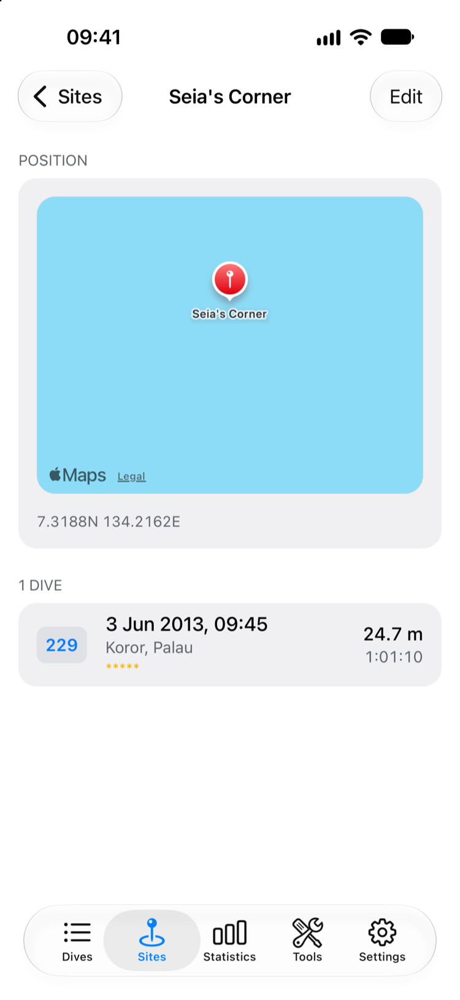
</p>

## Know your diving

Total time, depth and air consumption across the whole log, or filtered to one
year or one site. Charts break down dives per year, by depth and by duration, along
with average SAC per year.

<p align="center">
  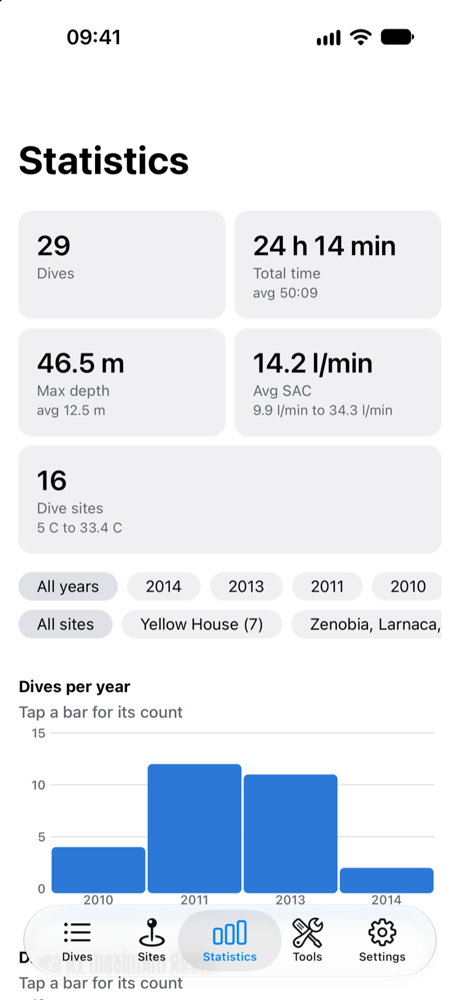
  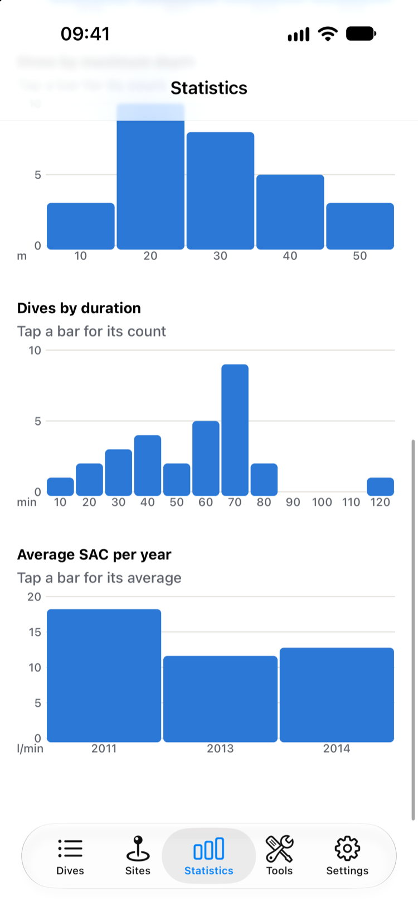
  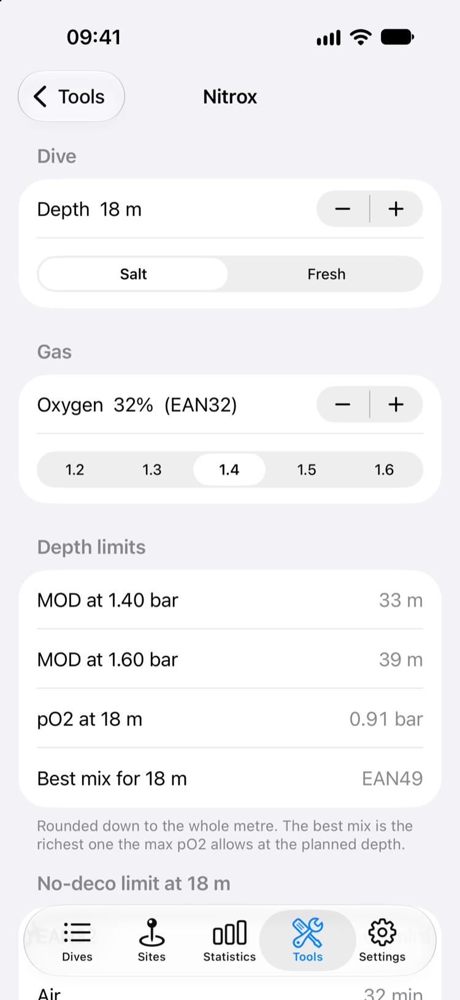
</p>

A **nitrox calculator** rounds it out: MOD, pO2, best mix, and the no-deco limit
against air, for salt or fresh water.

## Your data stays yours

- **The logbook is a file.** No database and no lock-in. Every change is written to a
  standard SSRF file that desktop Subsurface reads.
- **No account, no analytics, no crash reporting.** Problems go to a log on the device
  that you can read, share or clear.
- **Back up with git.** Optional sync keeps the logbook in your own repository over SSH.
- **Ask an AI about your diving.** An optional, read-only MCP server lets an assistant
  on your network read the logbook. It is off by default, has no password, and turns
  off again on the next launch.
- **Free software.** GPL-2.0, like the Subsurface core it is built on.

Dive data only leaves the device when you export it, or use SSI or git sync. The
maps load their tiles from Apple Maps on iOS and OpenFreeMap on Android.

## At home on your phone

Native controls throughout: liquid glass on iOS 26 and later, Material on Android,
dark mode, metric or imperial units, and VoiceOver labels on the profile and the
dive list.

<sub>Screenshots: version 1.5.0 on the iOS 27 simulator, showing the unmodified
upstream sample logbook, `subsurface/dives/SampleDivesV2.ssrf`.</sub>

## Use at your own risk

Subsurface Mobile is a logbook and a set of planning aids, not a dive computer
and not a medical device. The decompression figures (ceilings, calculated NDL
and TTS, tissue loading, surface GF), the planner, and the gas and nitrox
calculators come from published models applied to the data you logged or
entered. They can be wrong and have had limited testing. Do not plan or
conduct a dive on them alone: check every figure against another source and
your dive computer, and dive within your training. The app says the same
under the Tools list, on each calculator, under a dive's profile, and in
Settings > About.

## Availability

The app is not in any app store. Build it from source, as described under
[Getting started](#getting-started). [docs/release.md](docs/release.md) covers
distribution.

## Not in yet

- Dive computer firmware update
- Android USB serial and Bluetooth classic downloads

## Architecture

TS / React Native (Expo Router, @expo/ui, react-native-skia) over a native
`ssrf-core` module that owns the in-memory `divelog` and serializes to SSRF XML.
The SSRF file is the source of truth — no separate database.

The upstream C++ core is vendored via the `subsurface/` git submodule, pinned to
a fixed commit and consumed read-only. See
`modules/ssrf-core/cpp/CORE_MANIFEST.md` for the vendored file list and pin.

## Requirements

- Xcode + iOS 26 SDK, with a native development build on an iOS device or
  simulator. The native C++ module does not run in Expo Go.
- Node LTS, `git`, CocoaPods.
- For Android: Android SDK with NDK 27.1.12297006 (the one React Native pins),
  JDK 17, and `ANDROID_HOME` set. Devices and emulators must be 64-bit
  (`arm64-v8a` or `x86_64`).
- Expo dev-client, SDK 54+ (not Expo Go — a custom native module requires
  `expo prebuild` + a dev client).

## Getting started

```sh
git clone --recurse-submodules <this-repo-url>
cd subsurface-mobile
bun install
npx expo prebuild
npx expo run:ios      # onto a physical device
npx expo run:android  # onto a device or emulator
```

Simulator builds must keep code signing enabled. Use Xcode's default ad-hoc
simulator signing; do not pass `CODE_SIGNING_ALLOWED=NO` to `xcodebuild`.
Unsigned builds can launch but cannot use Keychain, so SSI sign-in fails with
“A required entitlement is not present.” For a direct simulator build, use
`CODE_SIGNING_ALLOWED=YES CODE_SIGN_IDENTITY=-`.

The native libraries the C++ modules link are committed prebuilt, per platform:
`modules/*/ios/vendor` (xcframeworks) and `modules/*/android/vendor` (static
archives per ABI). Rebuild them only when bumping a version, with the
`build-*.sh` script next to each.

The dive-site map is Apple Maps on iOS and, on Android, MapLibre with
[OpenFreeMap](https://openfreemap.org/) tiles, which need no API key. Everything else - import, profile, statistics, editing, export,
SSI and git sync - works the same.

## Downloading from SSI

Under Settings, SSI, Logbook, once signed in: choose SSI dives to add, replace the
logbook with all of them, or save them as a `.ssrf` file to share or open as a new
logbook. None of these writes to SSI.

## Production and testing app

iOS ships as two separately installable apps, so a build under test never
touches the logbook of the one you dive with (see
`plugins/with-ios-variants.js`):

| Build | Bundle identifier | Home screen | Icon | URL scheme |
| --- | --- | --- | --- | --- |
| `npx expo run:ios --device` (Debug) | `codes.mani.subsurface-react.dev` | Subsurface Dev | amber (`assets/subsurface-dev.icon`) | `subsurface-dev` |
| `npx expo run:ios --device --configuration Release` or Xcode Archive | `codes.mani.subsurface-react` | Subsurface | blue (`assets/subsurface.icon`) | `subsurface` |

Each bundle identifier has its own sandbox and keychain: the logbook, settings
and SSI credentials are not shared. Re-run `npx expo prebuild` after changing
the plugin or either icon.

## Tests

```sh
bun run test          # vitest: models + golden tests against the real C++ bindings
bun run typecheck
bun run lint
```

The golden tests do not mock the native module: they build
`modules/ssrf-core` for the host and drive the same
`call(method, argsJson)` bindings the app uses over JSI, against the logbooks in
`subsurface/dives/`. macOS with the Xcode command line tools is therefore
required, and the submodule must be checked out.

```sh
SSRF_ASAN=1 bun run test   # adds the AddressSanitizer sweep over every fixture
```

Run that after any change to the C++ shim, the bindings or the pinned core:
memory errors there show up as rare silent data corruption rather than crashes.

Two things the suite structurally cannot check are written up as manual passes,
both with the values to compare against:

- [docs/device-acceptance.md](docs/device-acceptance.md) — gestures, the file
  picker, navigation-bar buttons, VoiceOver and large-log feel on a real device.
- [docs/interop-check.md](docs/interop-check.md) — opening a logbook the app
  exported in desktop Subsurface.

The app is distributed as a local dev-client build; the App Store route is not
pursued (see [docs/release.md](docs/release.md)).

## Development conventions

See [CLAUDE.md](CLAUDE.md) for the project invariants. In short: TypeScript
strict, ESLint + Prettier, every new source file starts with
`// AI-generated (Claude)`, no emojis, never edit anything under `subsurface/`.

Implementation is tracked task-by-task in [docs/tasks/](docs/tasks/) —
see [PROGRESS.md](docs/tasks/PROGRESS.md).

## License

GPL-2.0 — the Subsurface core is GPL-2.0, and linking it makes this app a
derivative work. See [LICENSE](LICENSE).
